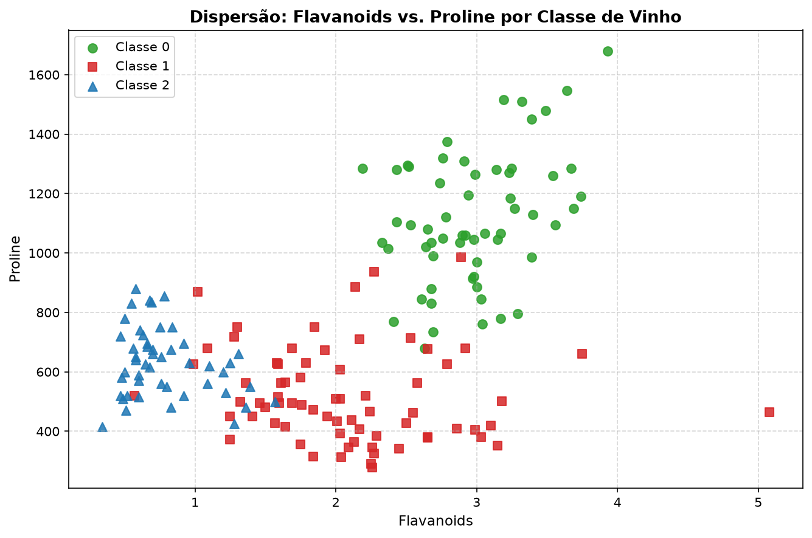
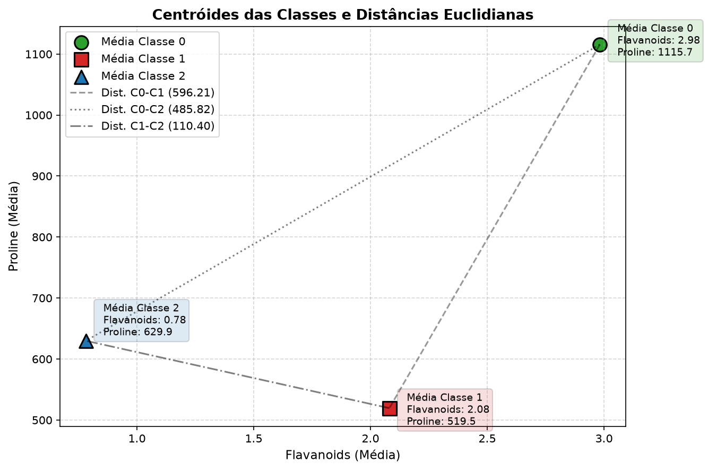

# Universidade Federal de Ouro Preto
## Instituto de Ciências Exatas e Aplicadas – ICEA
### CDD109 – Redes Neurais Artificiais e Deep Learning

**Professora:** Profa. Dra. Sarah Negreiros de Carvalho Leite  
**Atividade:** Projeto 1 – Analisando Vinhos  
**Aluno:** Leonardo Isaac Silva Flores  

---

## 1. Base de dados Wine (Scikit-Learn)

Carregamento da base de dados de vinhos usando `datasets.load_wine()` do Scikit-Learn. Os dados contêm análises químicas de vinhos de três produtores diferentes da mesma região da Itália.

### Minha observação:
A base veio completa, sem nenhum dado faltante (`NaN`). São 13 características químicas medidas em laboratório (como teor alcoólico, acidez e polifenóis) e 3 tipos de vinho para identificar.

---

## 2. Dimensão dos dados e rótulos

- **Matriz de dados ($X$):** dimensão $(178, 13)$ -> 178 amostras e 13 variáveis por amostra.
- **Vetor de rótulos ($Y$):** dimensão $(178,)$ -> classes 0, 1 e 2.
- **Características:** `alcohol`, `malic_acid`, `ash`, `alcalinity_of_ash`, `magnesium`, `total_phenols`, `flavanoids`, `nonflavanoid_phenols`, `proanthocyanins`, `color_intensity`, `hue`, `od280/od315_of_diluted_wines`, `proline`.

### Minha observação:
Cada linha da matriz $X$ representa uma garrafa de vinho com suas 13 medidas químicas, e o vetor $Y$ indica a qual dos três cultivos ela pertence. Temos um problema típico de classificação com 178 exemplos.

---

## 3. Contagem de amostras por classe

Contagem feita com indexação lógica no NumPy (`sum(Y == classe)`):
- **Classe 0:** 59 amostras ($33{,}1\%$)
- **Classe 1:** 71 amostras ($39{,}9\%$)
- **Classe 2:** 48 amostras ($27{,}0\%$)
- **Total:** 178 amostras

### Minha observação:
As três classes estão bem equilibradas, variando entre 48 e 71 amostras. Nenhuma classe domina a base nem fica em minoria extrema, o que facilita o treinamento de modelos e torna a acurácia uma métrica justa para avaliação.

---

## 4. Estatísticas separadas por classe de vinho

Os dados foram divididos em fatias conforme os limites de cada classe (`x_vinho1 = X[0:59]`, `x_vinho2 = X[59:130]`, `x_vinho3 = X[130:178]`). Em seguida, foram calculados máximo, mínimo, média e desvio padrão de cada variável (`axis=0`).

Principais contrastes médios encontrados:
- **Álcool:** Classe 0 = $13{,}74\%$ | Classe 1 = $12{,}28\%$ | Classe 2 = $13{,}15\%$
- **Flavanoids:** Classe 0 = $2{,}98$ | Classe 1 = $2{,}08$ | Classe 2 = $0{,}78$
- **Color Intensity:** Classe 0 = $5{,}53$ | Classe 1 = $3{,}09$ | Classe 2 = $7{,}40$
- **Proline:** Classe 0 = $1115{,}71\,\text{mg/L}$ | Classe 1 = $519{,}51\,\text{mg/L}$ | Classe 2 = $629{,}90\,\text{mg/L}$

### Minha observação:
Dá para notar diferenças claras entre as classes: a classe 0 tem muito mais *Proline* (média de 1115 contra ~500-600 das outras) e maior teor alcoólico. A classe 2 tem a cor mais escura e intensa ($7{,}40$) e o menor nível de flavonoides ($0{,}78$). Essas diferenças mostram que as variáveis têm bom poder para separar os vinhos.

---

## 5. Gráfico de dispersão: Flavanoids vs. Proline

Gráfico cruzando *Flavanoids* (coluna 6, eixo x) com *Proline* (coluna 12, eixo y) para cada classe:
- Verde: Classe 0
- Vermelho: Classe 1
- Azul: Classe 2

### Minha observação:
Mesmo usando apenas 2 das 13 características, os três grupos já ficam praticamente separados no gráfico:
- **Classe 0 (verde):** fica no topo, com Proline alta e Flavanoids altos;
- **Classe 1 (vermelho):** fica embaixo à direita, com Proline baixa e Flavanoids médios/altos;
- **Classe 2 (azul):** fica embaixo à esquerda, com Flavanoids baixos e Proline intermediária.

Quase não há sobreposição entre os pontos, o que mostra que essas duas variáveis sozinhas já resolvem boa parte da classificação.

---

## 6. Médias das classes e Distâncias Euclidianas

Pontos médios calculados para cada classe $(\text{Flavanoids}, \text{Proline})$:
- **Média Classe 0:** $[2{,}98;\; 1115{,}71]$
- **Média Classe 1:** $[2{,}08;\; 519{,}51]$
- **Média Classe 2:** $[0{,}78;\; 629{,}90]$

Distâncias Euclidianas calculadas entre os pontos médios ($\sqrt{\sum (p_i - q_i)^2}$):
- **Distância Classe 0 – Classe 1:** **$596{,}21$**
- **Distância Classe 0 – Classe 2:** **$485{,}82$**
- **Distância Classe 1 – Classe 2:** **$110{,}40$**

### Minha observação:
Duas coisas chamam atenção nesses resultados:
1. As classes 1 e 2 estão muito mais próximas entre si (distância de $110{,}40$) do que da classe 0 (quase 500 e 600).
2. A variável *Proline* varia na casa das centenas a milhares (500 a 1100), enquanto *Flavanoids* varia entre 0 e 3. Por isso, a Proline domina quase $100\%$ da conta da distância euclidiana bruta. Isso prova na prática por que precisamos normalizar os dados (`StandardScaler` ou MinMax) antes de rodar algoritmos como Redes Neurais: sem isso, variáveis com números grandes engolem as variáveis menores, mesmo que as menores sejam muito informativas.

---

## 7. Conclusão

O exercício permitiu praticar fatiamento de matrizes, operações com NumPy e visualização com Matplotlib. A base Wine se mostrou bem comportada e facilmente separável. O cálculo das distâncias deixou evidente a necessidade de normalizar atributos com grandezas muito diferentes antes de alimentar modelos de aprendizado de máquina.
